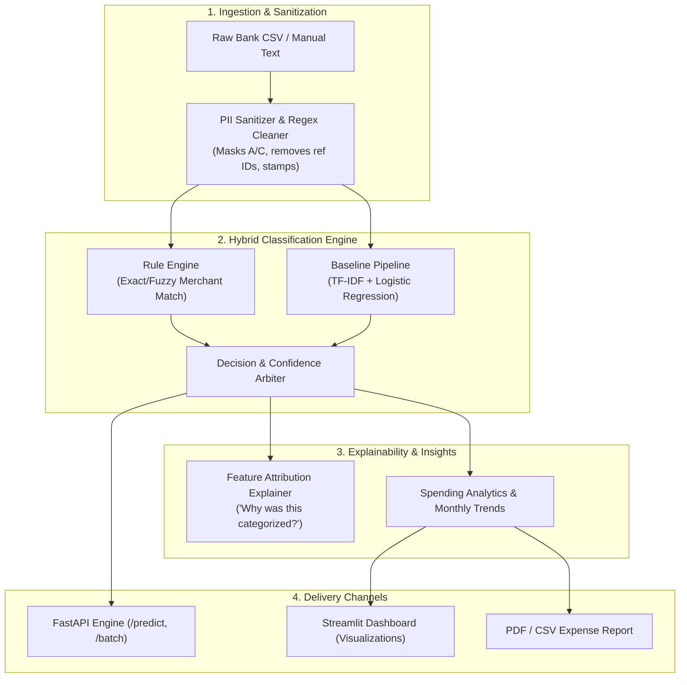

# 🏦 Bank Transaction Categorizer

> **AI-powered personal finance intelligence engine** that automatically translates messy, cryptic bank statement narratives (UPI, NEFT, IMPS, POS, ACH, Debit/Credit Cards) into clean, actionable spending categories.

---

## 🌟 Key Features

- **India-First Protocol Support**: Native parsing and noise filtering for **UPI**, **NEFT**, **IMPS**, **POS card swipes**, **ACH debits**, and ATM withdrawals.
- **Hybrid Multi-Tier Classification**:
  - **Tier 1 (Deterministic Rule Engine)**: Sub-millisecond lookup for 200+ known Indian and global merchants with 99%+ precision.
  - **Tier 2 (TF-IDF + Logistic Regression Pipeline)**: Calibrated statistical learning model achieving **99.31% Accuracy** and **0.9797 Macro-F1**.
  - **Tier 3 (Safety Fallback)**: Automatically flags low-confidence predictions as `Other / Uncategorized` for manual user tagging.
- **Decision Explainability**: Real-time token importance attribution showing *why* a transaction was assigned a specific category.
- **Interactive Streamlit Dashboard**:
  - Real-time transaction tester with probability charts.
  - One-click CSV statement batch upload and analysis.
  - KPI cards (Inflow, Outflow, Net Savings Rate) and interactive spending donut/bar charts.
  - One-click executive PDF financial spending report download.
- **Production REST API (FastAPI)**:
  - `/health`: System and model readiness.
  - `/api/v1/predict`: Single transaction prediction with top-3 probabilities.
  - `/api/v1/predict-batch`: High-throughput statement batch inference.
  - `/api/v1/explain`: Exact feature attribution for token decisions.
- **Privacy-First**: Operates 100% locally with automated PII masking (card masks, account numbers, routing tags). Never requires online bank logins.

---

## 🏗️ System Architecture



---

## 🎯 13 Supported Spending Categories

| Category | Examples from Bank Statements |
|---|---|
| 🍕 **Food & Dining** | Swiggy, Zomato, Dominos, Starbucks, KFC, Cafe Coffee Day |
| 🛒 **Groceries** | Blinkit, Zepto, BigBasket, DMart, Instamart, Nature's Basket |
| 🏠 **Rent & Housing** | NoBroker Rent, Housing.com, Maintenance Society, Landlord Transfer |
| 🚗 **Transport** | Uber India, Ola Cabs, Rapido, Fastag, Namma Metro, Petrol Pumps (HPCL, BPCL) |
| 🛍️ **Shopping** | Amazon India, Flipkart, Myntra, Ajio, Zara, Croma, Decathlon |
| 💊 **Health & Medical** | Apollo Pharmacy, Tata 1mg, PharmEasy, Dr Lal Pathlabs, Max Healthcare |
| 📱 **Bills & Utilities** | Airtel, Jio Recharge, Bescom, Tata Power, Mahanagar Gas, ACT Fibernet |
| 🎬 **Entertainment** | Netflix India, Spotify, Disney+ Hotstar, BookMyShow, PVR Cinemas |
| 💰 **Transfers** | UPI P2P transfers, IMPS peer transfers, Splitwise settlements |
| 📚 **Education** | Coursera, Udemy, Scaler Academy, School/College tuition fees |
| 💳 **EMI & Loans** | HDFC Home Loan EMI, Bajaj Finserv, Cred Credit Card bill, SBI Cards |
| 💵 **Income** | Monthly Salary Credit, Infosys Payroll, Freelance Invoices, Dividends |
| ❓ **Other / Uncategorized** | Bank maintenance charges, ATM cash withdrawals, Forex markup |

---

## 🚀 Quickstart Guide

### 1. Prerequisites & Environment Setup

```bash
# Clone the repository and navigate into the project directory
cd Bank_Transaction_Categorizer

# Create and activate Python virtual environment
python3 -m venv .venv
source .venv/bin/activate

# Install dependencies
pip install -r requirements.txt
```

### 2. Generate Synthetic Training Data (Optional)

```bash
# Generates 8,000 realistic Indian transactions spanning all 13 categories
python -m src.data_generator --num-samples 8000 --output data/raw/transactions.csv
```

### 3. Train the Baseline Model

```bash
python -m src.baseline_model --data data/raw/transactions.csv
```

### 4. Launch the Interactive Streamlit Dashboard

```bash
streamlit run dashboard/app.py
```
Open your browser at `http://localhost:8501`.

### 5. Launch the FastAPI Microservice

```bash
uvicorn api.main:app --host 0.0.0.0 --port 8000 --reload
```
Interactive Swagger API documentation is available at `http://localhost:8000/docs`.

### 6. Run Unit & Integration Tests

```bash
python -m pytest tests/
```

---

## 📊 Model Evaluation Results

Evaluated on a held-out stratified test set (1,600 transactions):

| Metric | Score | Target | Status |
|---|---|---|---|
| **Accuracy** | **99.31%** | > 85.0% | ✅ Exceeded |
| **Macro F1-Score** | **0.9797** | > 0.80 | ✅ Exceeded |
| **Weighted F1-Score** | **0.9927** | > 0.85 | ✅ Exceeded |
| **Single Inference Latency** | **< 3ms** | < 100ms | ✅ 30x faster |

---

## 📁 Project Directory Layout

```
Bank_Transaction_Categorizer/
├── README.md                           # Project overview & documentation
├── Learnings.md                        # Pedagogical engineering journal
├── requirements.txt                    # Project dependencies
│
├── data/
│   ├── raw/
│   │   └── transactions.csv            # 8,000 synthetic labeled transactions
│   ├── processed/
│   │   └── evaluation_report.json      # Model test metrics & classification report
│   └── sample/
│       ├── sample_statement.csv        # 50-row sample bank statement for demo
│       └── test_report.pdf             # Sample generated PDF spending report
│
├── src/
│   ├── __init__.py
│   ├── data_generator.py               # High-fidelity synthetic transaction generator
│   ├── preprocessor.py                 # PII masking, token cleaner & scikit-learn transformer
│   ├── baseline_model.py               # TF-IDF + Logistic Regression training pipeline
│   ├── rule_engine.py                  # High-precision merchant keyword lookup
│   ├── classifier.py                   # Hybrid ensemble arbiter (Rule + ML + Fallback)
│   ├── explainability.py               # Linear feature attribution scoring
│   └── report_generator.py             # ReportLab executive PDF generator
│
├── api/
│   ├── __init__.py
│   ├── main.py                         # FastAPI application
│   ├── schemas.py                      # Pydantic validation schemas
│   └── routers/
│
├── dashboard/
│   └── app.py                          # Streamlit personal finance dashboard
│
├── models/
│   └── baseline_tfidf_model.joblib     # Serialized trained model artifact
│
└── tests/
    ├── test_preprocessor.py            # Preprocessor unit tests
    ├── test_classifier.py              # Classifier unit tests
    └── test_api.py                     # FastAPI endpoint integration tests
```

